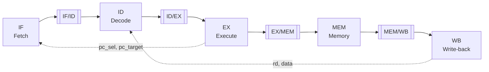

# Architecture

## Overview

pipeRV implements the RV32I base integer instruction set in a classic five-stage pipeline:



Each stage is purely combinational logic. The pipeline registers between the stages hold all state and only implement reset, stall and flush. A top-level module wires stages and registers together.

### Planned module hierarchy

```
cpu_top
├── instruction_fetcher          IF + IF/ID register
│   ├── program_counter
│   └── imem
├── decode_stage                 ID
│   ├── instruction_decoder
│   │   └── immediate_generator
│   ├── control_unit
│   └── register_file
├── id_ex_reg
├── execute_stage                EX (planned)
├── ex_mem_reg                   (planned)
├── memory_stage                 MEM (planned)
├── mem_wb_reg                   (planned)
└── hazard / forwarding units    (planned)
```

## Design conventions

- **Reset** is asynchronous and active low (`rst_n`).
- **Bit order** is descending (`[31:0]`), bit 0 is the LSB, matching the RISC-V specification.
- **NOP** is `0x00000013` (`addi x0, x0, 0`). Pipeline registers output it after reset and on flush.
- **Flush beats stall.** If a pipeline register sees both, it flushes, because the instruction it would hold is on the wrong path anyway.
- **Bubbles** are created by clearing the control signals only. With `reg_write`, `mem_write`, `branch` and `jump` at 0 an instruction has no effect, so its data fields do not need to be cleared.
- Types and constants shared between modules live in `riscv_pkg`. Any Makefile that uses it must list `riscv_pkg.sv` before the modules that import it.

## Modules

### `program_counter`

Holds the address of the instruction being fetched.

| Port | Dir | Width | Description |
|---|---|---|---|
| `clk` | in | 1 | clock |
| `rst_n` | in | 1 | asynchronous reset, active low, sets PC to 0 |
| `stall` | in | 1 | hold the current PC |
| `pc_sel` | in | 1 | 1 = load `pc_target` instead of `pc + 4` |
| `pc_target` | in | 32 | branch or jump target |
| `pc` | out | 32 | current PC |

Priority: reset > `pc_sel` > `stall` > `pc + 4`.

### `imem`

Instruction memory, read combinationally. It is word addressed internally, so `read_address` is a byte address and the lower two bits are ignored. In simulation the memory array is loaded from Python via `tests/helpers/instruction_memory_model.py`.

| Port | Dir | Width | Description |
|---|---|---|---|
| `read_address` | in | 32 | byte address |
| `instr` | out | 32 | instruction at that address |

### `instruction_fetcher`

IF stage plus the IF/ID pipeline register. Instantiates `program_counter` and `imem`.

| Port | Dir | Width | Description |
|---|---|---|---|
| `clk`, `rst_n` | in | 1 | clock, reset |
| `stall` | in | 1 | hold PC and IF/ID register |
| `pc_sel`, `pc_target` | in | 1, 32 | redirect fetch; also flushes IF/ID |
| `instr_out` | out | 32 | fetched instruction (NOP after reset or flush) |
| `pc_out` | out | 32 | address of `instr_out` |

After reset is released, the instruction at word `i` appears on `instr_out` after `i + 1` clock edges, together with `pc_out = 4 * i`.

### `instruction_decoder`

Splits an instruction into its fields. Fields are always extracted, whether the instruction uses them or not; the control unit decides what is relevant.

| Port | Dir | Width | Bits | Description |
|---|---|---|---|---|
| `instr` | in | 32 | | instruction |
| `opcode` | out | 7 | `[6:0]` | |
| `rd` | out | 5 | `[11:7]` | destination register |
| `funct3` | out | 3 | `[14:12]` | |
| `addr_reg_1` | out | 5 | `[19:15]` | rs1 |
| `addr_reg_2` | out | 5 | `[24:20]` | rs2 |
| `funct7` | out | 7 | `[31:25]` | |
| `imm` | out | 32 | | from `immediate_generator` |

### `immediate_generator`

Builds the sign-extended 32-bit immediate, selected by opcode.

| Format | Opcodes | Immediate |
|---|---|---|
| I | OP-IMM, LOAD, JALR | `{{20{i[31]}}, i[31:20]}` |
| S | STORE | `{{20{i[31]}}, i[31:25], i[11:7]}` |
| B | BRANCH | `{{19{i[31]}}, i[31], i[7], i[30:25], i[11:8], 1'b0}` |
| U | LUI, AUIPC | `{i[31:12], 12'b0}` |
| J | JAL | `{{11{i[31]}}, i[31], i[19:12], i[20], i[30:21], 1'b0}` |
| — | R-type, SYSTEM, others | `0` |

`i[31]` is the sign bit in every format. B and J immediates have an implicit 0 as LSB because jump targets are always 2-byte aligned.

### `register_file`

32 × 32-bit registers, two combinational read ports and one synchronous write port. `x0` always reads as 0 and ignores writes.

| Port | Dir | Width | Description |
|---|---|---|---|
| `clk` | in | 1 | clock |
| `addr_reg_1`, `addr_reg_2` | in | 5 | read addresses (rs1, rs2) |
| `data_reg1`, `data_reg2` | out | 32 | read data |
| `write_destination` | in | 5 | write address (rd) |
| `write_data` | in | 32 | write data |
| `w_en` | in | 1 | write enable |

Registers are read in ID but written in WB, so the write port is driven by the write-back stage.

Open point: a write and a read of the same register in the same cycle currently returns the old value. An internal bypass is planned (`test_write_read_bypass` is skipped until then).

### `control_unit` *(in progress)*

Combinational. Derives the control signals from `opcode`, `funct3` and `funct7` and groups them by the stage that uses them.

| Struct | Field | Meaning |
|---|---|---|
| `ex_ctrl_t` | `alu_op` | ALU operation (`ALU_*` in `riscv_pkg`) |
| | `alu_src_a` | 0 = rs1, 1 = pc |
| | `alu_src_b` | 0 = rs2, 1 = imm |
| | `branch` | conditional branch, condition from `funct3` |
| | `jump` | JAL |
| | `jalr` | JALR, target = rs1 + imm |
| `mem_ctrl_t` | `mem_read` | load |
| | `mem_write` | store |
| `wb_ctrl_t` | `reg_write` | write `rd` |
| | `wb_sel` | `WB_ALU`, `WB_MEM` or `WB_PC4` |

Settings per instruction type (empty = 0):

| Type | alu_op | src_a | src_b | branch | jump | jalr | mem_read | mem_write | reg_write | wb_sel |
|---|---|---|---|---|---|---|---|---|---|---|
| R | from funct3/7 | rs1 | rs2 | | | | | | 1 | ALU |
| I arithmetic | from funct3/7 | rs1 | imm | | | | | | 1 | ALU |
| Load | ADD | rs1 | imm | | | | 1 | | 1 | MEM |
| Store | ADD | rs1 | imm | | | | | 1 | | |
| Branch | SUB | rs1 | rs2 | 1 | | | | | | |
| LUI | PASS_B | | imm | | | | | | 1 | ALU |
| AUIPC | ADD | pc | imm | | | | | | 1 | ALU |
| JAL | | | | | 1 | | | | 1 | PC+4 |
| JALR | ADD | rs1 | imm | | | 1 | | | 1 | PC+4 |
| others | | | | | | | | | | |

FENCE, ECALL, EBREAK and unknown opcodes decode to a NOP. There is no `subi`: for I-type arithmetic, `funct7[5]` only selects between `srli` and `srai`.

### `id_ex_reg` *(in progress)*

Pipeline register between ID and EX. Stores the three control structs plus `pc`, `rs1_data`, `rs2_data`, `imm`, `rs1`, `rs2`, `rd` and `funct3`.

- `rs1` / `rs2` are kept for the forwarding unit.
- `funct3` is needed in EX (branch condition) and MEM (load/store width).
- `flush` clears only the control structs (bubble).
- `stall` holds all contents.

## Hazards *(planned)*

| Hazard | Cause | Handling |
|---|---|---|
| Data (ALU → ALU) | operand produced by one of the previous two instructions | forwarding from EX/MEM and MEM/WB |
| Load-use | operand produced by the directly preceding load | stall PC and IF/ID one cycle, bubble into ID/EX |
| Control | taken branch or jump, resolved in EX | `pc_sel` redirects the PC, IF/ID and ID/EX are flushed |
| WB → ID | register written and read in the same cycle | bypass inside `register_file` |

## Testing

Every module has its own folder under `tests/` containing a `Makefile` and `test_<module>.py`. Tests use `assert`, so a failing check fails the test (logging alone does not).

Conventions used in the testbenches:

- Combinational modules: drive inputs, wait 1 ns, read outputs.
- Clocked modules: a `setup()` helper starts a 10 ns clock, drives every input to a known value and applies reset. A `step()` helper waits for a rising edge plus 1 ns, so inputs are always changed far away from the next edge.
- Inputs that are not driven are `X` in simulation and propagate, so every new port must be initialised in `setup()`.
- Expected negative values are written as Python ints and masked with `& 0xFFFFFFFF` before comparing.
