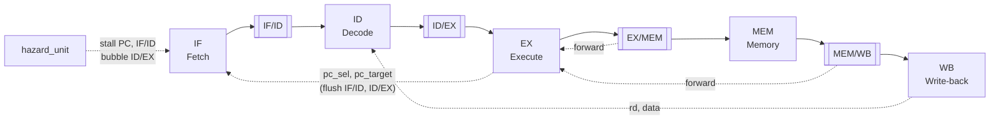
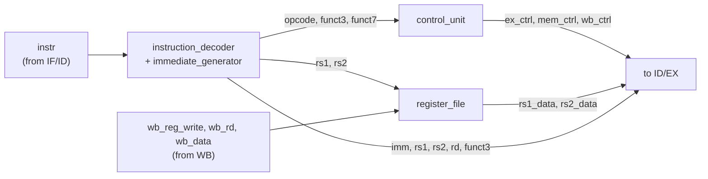

# Architecture

## Overview

pipeRV implements the RV32I base integer instruction set in a classic five-stage, in-order pipeline with full forwarding and load-use hazard detection. It runs arbitrary RV32I programs without NOPs inserted by the programmer.



Each stage is purely combinational logic. The pipeline registers between the stages hold all state and only implement reset, stall and flush. `cpu_top` wires stages, registers, the forwarding unit and the hazard unit together.

### Module hierarchy

```
cpu_top
├── instruction_fetcher          IF + IF/ID register
│   ├── program_counter
│   └── imem
├── decode_stage                 ID
│   ├── instruction_decoder
│   │   └── immediate_generator
│   ├── control_unit
│   └── register_file            incl. WB -> ID bypass
├── id_ex_reg
├── execute_stage                EX
│   ├── alu
│   └── branch_unit
├── ex_mem_reg
├── memory_stage                 MEM
│   └── data_memory
├── mem_wb_reg
├── writeback_stage              WB
├── forwarding_unit
└── hazard_unit
```

### Cycle costs

| Situation | Cost |
|---|---|
| Any instruction, no hazard | 1 cycle (CPI 1) |
| ALU result used by the next instruction | 0 extra, forwarded |
| Load result used by the next instruction | 1 stall cycle |
| Taken branch, `jal`, `jalr` | 2 cycles (two flushed instructions) |

Branches are resolved in EX and there is no branch prediction yet, so fetch always continues at `pc + 4` and a taken branch discards the two instructions behind it.

## Design conventions

- **Reset** is asynchronous and active low (`rst_n`).
- **Bit order** is descending (`[31:0]`), bit 0 is the LSB, matching the RISC-V specification.
- **NOP** is `0x00000013` (`addi x0, x0, 0`). The IF/ID register outputs it after reset and on flush.
- **Flush beats stall.** If a pipeline register sees both, it flushes, because the instruction it would hold is on the wrong path anyway.
- **Bubbles** are created by clearing the control signals only. With `reg_write`, `mem_write`, `branch` and `jump` at 0 an instruction has no effect, so its data fields do not need to be cleared.
- **Shared types** live in `riscv_pkg`. Modules import it in their header (`module foo import riscv_pkg::*; (...)`), not at file level, to keep the compilation-unit namespace clean. Any Makefile that uses it must list `riscv_pkg.sv` first.
- **Functions get everything they read as arguments.** A function called from a continuous assignment is only re-evaluated when its arguments change. If it reads module signals directly, the output silently misses their changes (this happened in the first version of `forwarding_unit`).
- **Memories are sized by a `DEPTH` parameter** and indexed with exactly `$clog2(DEPTH)` address bits, so an address outside the memory wraps around instead of reading `X`.

## Modules

### IF stage

#### `program_counter`

Holds the address of the instruction being fetched.

| Port | Dir | Width | Description |
|---|---|---|---|
| `clk` | in | 1 | clock |
| `rst_n` | in | 1 | asynchronous reset, active low, sets PC to 0 |
| `stall` | in | 1 | hold the current PC |
| `pc_sel` | in | 1 | 1 = load `pc_target` instead of `pc + 4` |
| `pc_target` | in | 32 | branch or jump target |
| `pc` | out | 32 | current PC |

Priority: reset > `pc_sel` > `stall` > `pc + 4`.

#### `imem`

Instruction memory, read combinationally. Parameter `DEPTH` (default 1024 words). `read_address` is a byte address; bits `[$clog2(DEPTH)+1:2]` select the word.

| Port | Dir | Width | Description |
|---|---|---|---|
| `read_address` | in | 32 | byte address |
| `instr` | out | 32 | instruction at that address |

In simulation the array `memory` is written directly from Python (`sim/helpers/instruction_memory_model.py`, or by the CPU-level tests).

#### `instruction_fetcher`

IF stage plus the IF/ID pipeline register. Instantiates `program_counter` and `imem`.

| Port | Dir | Width | Description |
|---|---|---|---|
| `clk`, `rst_n` | in | 1 | clock, reset |
| `stall` | in | 1 | hold PC and IF/ID register |
| `pc_sel`, `pc_target` | in | 1, 32 | redirect fetch; also flushes IF/ID |
| `instr_out` | out | 32 | fetched instruction (NOP after reset or flush) |
| `pc_out` | out | 32 | address of `instr_out` |

After reset is released, the instruction at word `i` appears on `instr_out` after `i + 1` clock edges, together with `pc_out = 4 * i`.

### ID stage

#### `instruction_decoder`

Splits an instruction into its fields. Fields are always extracted, whether the instruction uses them or not; the control unit decides what is relevant.

| Port | Dir | Width | Bits | Description |
|---|---|---|---|---|
| `instr` | in | 32 | | instruction |
| `opcode` | out | 7 | `[6:0]` | |
| `rd` | out | 5 | `[11:7]` | destination register |
| `funct3` | out | 3 | `[14:12]` | |
| `addr_reg_1` | out | 5 | `[19:15]` | rs1 |
| `addr_reg_2` | out | 5 | `[24:20]` | rs2 |
| `funct7` | out | 7 | `[31:25]` | |
| `imm` | out | 32 | | from `immediate_generator` |

#### `immediate_generator`

Builds the sign-extended 32-bit immediate, selected by opcode.

| Format | Opcodes | Immediate |
|---|---|---|
| I | OP-IMM, LOAD, JALR | `{{20{i[31]}}, i[31:20]}` |
| S | STORE | `{{20{i[31]}}, i[31:25], i[11:7]}` |
| B | BRANCH | `{{19{i[31]}}, i[31], i[7], i[30:25], i[11:8], 1'b0}` |
| U | LUI, AUIPC | `{i[31:12], 12'b0}` |
| J | JAL | `{{11{i[31]}}, i[31], i[19:12], i[20], i[30:21], 1'b0}` |
| — | R-type, SYSTEM, others | `0` |

`i[31]` is the sign bit in every format. B and J immediates have an implicit 0 as LSB because jump targets are always 2-byte aligned.

#### `register_file`

32 × 32-bit registers, two combinational read ports and one synchronous write port. `x0` always reads as 0 and ignores writes.

| Port | Dir | Width | Description |
|---|---|---|---|
| `clk` | in | 1 | clock |
| `addr_reg_1`, `addr_reg_2` | in | 5 | read addresses (rs1, rs2) |
| `data_reg1`, `data_reg2` | out | 32 | read data |
| `write_destination` | in | 5 | write address (rd) |
| `write_data` | in | 32 | write data |
| `w_en` | in | 1 | write enable |

Registers are read in ID but written in WB, so the write port is driven by the write-back stage. **Internal bypass:** if WB writes the register that ID reads in the same cycle, the read port returns `write_data` instead of the old array value. This covers a producer three instructions ahead, which the forwarding unit no longer sees.

#### `control_unit`

Combinational. Derives the control signals from `opcode`, `funct3` and `funct7` and groups them by the stage that uses them.

| Struct | Field | Meaning |
|---|---|---|
| `ex_ctrl_t` | `alu_op` | ALU operation (`ALU_*` in `riscv_pkg`) |
| | `alu_src_a` | 0 = rs1, 1 = pc |
| | `alu_src_b` | 0 = rs2, 1 = imm |
| | `branch` | conditional branch, condition from `funct3` |
| | `jump` | JAL |
| | `jalr` | JALR, target = rs1 + imm |
| `mem_ctrl_t` | `mem_read` | load |
| | `mem_write` | store |
| `wb_ctrl_t` | `reg_write` | write `rd` |
| | `wb_sel` | `WB_ALU`, `WB_MEM` or `WB_PC4` |

Settings per instruction type (empty = 0):

| Type | alu_op | src_a | src_b | branch | jump | jalr | mem_read | mem_write | reg_write | wb_sel |
|---|---|---|---|---|---|---|---|---|---|---|
| R | from funct3/7 | rs1 | rs2 | | | | | | 1 | ALU |
| I arithmetic | from funct3/7 | rs1 | imm | | | | | | 1 | ALU |
| Load | ADD | rs1 | imm | | | | 1 | | 1 | MEM |
| Store | ADD | rs1 | imm | | | | | 1 | | |
| Branch | SUB | rs1 | rs2 | 1 | | | | | | |
| LUI | PASS_B | | imm | | | | | | 1 | ALU |
| AUIPC | ADD | pc | imm | | | | | | 1 | ALU |
| JAL | | | | | 1 | | | | 1 | PC+4 |
| JALR | ADD | rs1 | imm | | | 1 | | | 1 | PC+4 |
| others | | | | | | | | | | |

FENCE, ECALL, EBREAK and unknown opcodes decode to a NOP. There is no `subi`: for I-type arithmetic, `funct7[5]` only selects between `srli` and `srai`. The `ALU_SUB` for branches is not used for the decision, `branch_unit` compares on its own.

##### Bit layout of the control structs

The structs are `packed`, so outside SystemVerilog (in cocotb, in waveforms) they appear as plain bit vectors. The first field in the declaration occupies the highest bits:

| Struct | Width | Bits |
|---|---|---|
| `ex_ctrl_t` | 9 | `[8:5]` alu_op, `[4]` alu_src_a, `[3]` alu_src_b, `[2]` branch, `[1]` jump, `[0]` jalr |
| `mem_ctrl_t` | 2 | `[1]` mem_read, `[0]` mem_write |
| `wb_ctrl_t` | 3 | `[2]` reg_write, `[1:0]` wb_sel |

Several testbenches pack and unpack these by hand, so changing the field order in `riscv_pkg.sv` also requires updating them.

#### `decode_stage`

ID stage. Instantiates `instruction_decoder`, `control_unit` and `register_file` side by side and only wires them together; it contains no logic of its own. The control unit is deliberately not nested inside the decoder: it only needs `opcode`, `funct3` and `funct7`, so it can be tested on its own without building full instructions.



| Port | Dir | Width | Description |
|---|---|---|---|
| `clk` | in | 1 | clock, only used by the register file write port |
| `instr` | in | 32 | instruction from IF/ID |
| `wb_reg_write`, `wb_rd`, `wb_data` | in | 1, 5, 32 | register file write port, from WB |
| `ex_ctrl`, `mem_ctrl`, `wb_ctrl` | out | structs | control signals for EX, MEM, WB |
| `rs1_data`, `rs2_data` | out | 32 | register values |
| `imm` | out | 32 | sign-extended immediate |
| `rs1`, `rs2` | out | 5 | source register numbers, for forwarding and hazard detection |
| `rd` | out | 5 | destination register number |
| `funct3` | out | 3 | branch condition / memory access width |

#### `id_ex_reg`

Pipeline register between ID and EX. Stores the three control structs plus `pc`, `rs1_data`, `rs2_data`, `imm`, `rs1`, `rs2`, `rd` and `funct3`.

- `rs1` / `rs2` are kept for the forwarding unit.
- `funct3` is needed in EX (branch condition) and MEM (load/store width).
- `flush` clears only the control structs (bubble). In `cpu_top` it is driven by `pc_sel | stall`: on a taken branch the instruction in ID is on the wrong path, on a load-use stall it has to wait in ID.
- `stall` holds all contents (tied to 0 in `cpu_top`, ID/EX never holds).

### EX stage

#### `alu`

| `alu_op` | Result |
|---|---|
| ADD, SUB | `a + b`, `a - b` |
| SLL, SRL, SRA | shift `a` by `b[4:0]`; SRA copies the sign bit |
| SLT, SLTU | 1 if `a < b` signed / unsigned, else 0 |
| XOR, OR, AND | bitwise |
| PASS_B | `b` (for `lui`) |

#### `branch_unit`

Compares the two (forwarded) operands according to `funct3`: `beq`, `bne`, `blt`, `bge` (signed), `bltu`, `bgeu` (unsigned). `funct3 = 010` and `011` are not branch conditions and are never taken.

#### `execute_stage`

| Port | Dir | Width | Description |
|---|---|---|---|
| `ex_ctrl`, `pc`, `rs1_data`, `rs2_data`, `imm`, `funct3` | in | | from ID/EX |
| `forward_a`, `forward_b` | in | 2 | from `forwarding_unit`: `00` register file, `01` MEM/WB, `10` EX/MEM |
| `ex_mem_result` | in | 32 | value of the instruction in MEM (see `cpu_top`) |
| `wb_data` | in | 32 | value of the instruction in WB |
| `alu_result` | out | 32 | ALU output, also the memory address for loads and stores |
| `store_data` | out | 32 | rs2 after forwarding |
| `pc_plus4` | out | 32 | link value for `jal` / `jalr` |
| `pc_sel`, `pc_target` | out | 1, 32 | redirect fetch on a taken branch or jump |

Operand A is `pc` for `auipc`, otherwise the forwarded rs1. Operand B is `imm` or the forwarded rs2. Branch targets and `jal` use a separate adder (`pc + imm`); `jalr` uses the ALU result with bit 0 cleared, as the specification requires.

`pc_sel = jump | jalr | (branch & taken)`.

#### `ex_mem_reg`

Holds `mem_ctrl`, `wb_ctrl`, `alu_result`, `store_data`, `pc_plus4`, `rd` and `funct3`. No flush: a branch flushes the instructions behind it, the branch itself continues. `stall` exists for a future multi-cycle memory and is tied to 0.

### MEM stage

#### `data_memory`

Word-organised memory with byte enables. Parameter `DEPTH`. Combinational read of the whole word, synchronous write of the enabled bytes.

#### `memory_stage`

| Port | Dir | Width | Description |
|---|---|---|---|
| `clk` | in | 1 | clock |
| `mem_ctrl`, `addr`, `store_data`, `funct3` | in | | from EX/MEM |
| `load_data` | out | 32 | loaded value, sign- or zero-extended |
| `misaligned` | out | 1 | access not aligned to its width (for a future exception) |

Stores place the data in every matching byte lane (`{4{byte}}`, `{2{half}}`) and enable only the addressed lanes. Loads read the whole word, select the lane with `addr[1:0]` and extend it: `lb`/`lh` sign-extend, `lbu`/`lhu` zero-extend. A misaligned access is flagged but still performed.

On an FPGA, block RAM reads synchronously. The address would then have to be applied at the end of EX and the data would arrive in WB, which changes the load-use timing. `data_memory` is a separate module so that this can be swapped later.

#### `mem_wb_reg`

Holds `wb_ctrl`, `alu_result`, `load_data`, `pc_plus4` and `rd`. No stall or flush: once an instruction has left MEM, it always completes.

### WB stage

#### `writeback_stage`

Selects the value to write: `WB_ALU` → ALU result, `WB_MEM` → load data, `WB_PC4` → pc + 4. The unused `wb_sel = 11` gives 0. Outputs `reg_write`, `wb_rd`, `wb_data` go to the register file write port and `wb_data` also to the forwarding input of EX.

### Hazard handling

#### `forwarding_unit`

Compares rs1 / rs2 of the instruction in EX with rd of the instructions in MEM and WB.

```
forward = 10  if  EX/MEM.reg_write  and EX/MEM.rd != 0  and EX/MEM.rd == rs
          01  if  MEM/WB.reg_write  and MEM/WB.rd != 0  and MEM/WB.rd == rs
          00  otherwise
```

- **EX/MEM wins** over MEM/WB: if both write the same register, the instruction in MEM is the newer one.
- **x0 is excluded**: `addi x0, x0, 5` has `reg_write = 1` but never changes x0.
- **Value from EX/MEM**: `cpu_top` forwards `pc_plus4` instead of the ALU result when the instruction in MEM is a `jal`/`jalr` (`wb_sel = WB_PC4`). With branches resolved in EX this cannot happen yet (two bubbles follow every jump), but it will with branch prediction.

#### `hazard_unit`

```
load_use_stall = ID/EX.mem_read  and  ID/EX.rd != 0  and  (ID/EX.rd == ID.rs1  or  ID/EX.rd == ID.rs2)
```

A load produces its value only at the end of MEM, one cycle too late for the instruction directly behind it. On a stall, PC and IF/ID hold, ID/EX receives a bubble, and one cycle later the value arrives through the MEM/WB forwarding path.

Known limitation: rs1 / rs2 are compared even for instructions that do not read them (`lui`, `jal`, rs2 of I-type instructions, where those bits belong to the immediate). This can cause an unnecessary stall. It costs one cycle and never produces a wrong result. The fix is a `uses_rs1` / `uses_rs2` signal from the control unit.

#### Summary

| Hazard | Cause | Handling |
|---|---|---|
| Data, distance 1 | result of the previous instruction | forward from EX/MEM |
| Data, distance 2 | result of the instruction two ahead | forward from MEM/WB |
| Data, distance 3 | written in WB while read in ID | bypass inside `register_file` |
| Load-use | value of the directly preceding load | 1 stall cycle, then forward from MEM/WB |
| Control | taken branch or jump, resolved in EX | `pc_sel` redirects the PC, IF/ID and ID/EX are flushed |

## Testing

Every module has its own folder under `sim/` containing a `Makefile` and `test_<module>.py`. Tests use `assert`, so a failing check fails the test (logging alone does not). GitHub Actions runs every folder on each push.

### Conventions

- **Combinational modules:** drive inputs, wait 1 ns, read outputs.
- **Clocked modules:** a `setup()` helper starts a 10 ns clock, drives every input to a known value and applies reset. Inputs are always changed at a fixed distance from the rising edge (usually on the falling edge). If simulation time drifts, for example after several 1 ns waits, a helper must re-align to an edge first, otherwise inputs can change exactly on a rising edge and cause a race. The random memory test found exactly this bug in its own testbench.
- **Undriven inputs** are `X` in simulation and propagate, so every new port must be initialised in `setup()`. The CPU-level tests also clear registers and data memory before each run.
- **Negative expected values** are written as Python ints and masked with `& 0xFFFFFFFF`.
- **1-bit signals** are a `Logic` in cocotb 2.x and have no `.to_unsigned()`; `int(dut.signal.value)` works for both.
- **Icarus** prints `sorry: constant selects in always_* processes are not currently supported` for several modules. This only concerns the sensitivity list of `always_comb` and does not affect results.

### CPU-level tests

`sim/cpu_top` runs real programs on the whole pipeline and checks registers and data memory afterwards. Programs are written with a small assembler in `sim/helpers/riscv_asm.py`:

```python
p = Program()
p.addi(1, 0, 0)
p.addi(2, 0, 1)
p.addi(3, 0, 11)
p.label("loop")
p.add(1, 1, 2)
p.addi(2, 2, 1)
p.blt(2, 3, "loop")
p.halt()
```

It supports all RV32I instructions plus `li` and `halt`, resolves labels, and can insert NOPs (`padding`, `load_padding`). Those options were used to bring the pipeline up step by step: three NOPs per instruction without hazard handling, one NOP after loads with forwarding only, and none now.

### Checking the tests

After writing a test, a bug is deliberately inserted into the design to confirm the test catches it (a simple form of mutation testing). Examples: `bge` as `>` instead of `>=`, `lbu` sign-extending, swapped forwarding priority, x0 forwarded, no register file bypass, no flush in ID/EX, stall without a bubble.

The last one is instructive: without the bubble, the dependent instruction runs twice, first with a stale value and then with the correct one. For `add x4, x3, x3` the second run simply overwrites the first and the result is still right. Only a non-idempotent instruction such as `add x14, x14, x15` makes the bug visible. A test has to be built so that the fault actually changes the result.

### Test coverage

| Module | What is checked |
|---|---|
| `program_counter` | reset value, increment by 4, asynchronous reset during operation, stall holds and releases, jump loads the target and counts on, jump overrides stall |
| `imem` | instructions loaded through `InstructionMemoryModel` are read back at the right addresses |
| `instruction_fetcher` | NOP at PC 0 during reset, sequential fetch with matching `pc_out`, stall holds `instr_out` / `pc_out`, jump flushes the fetched instruction and continues at the target |
| `register_file` | x0 reads 0, all registers on both ports, write enable, random accesses against a model, same-cycle write/read bypass |
| `immediate_generator` | all formats with hand-checked instructions, boundary values, random immediates |
| `decode_stage` | field extraction, control signals for every instruction type (incl. negative `addi` and `srai`), immediate wiring, register read through the WB port, x0 and write enable |
| `alu` | edge values for every operation (overflow, signed vs. unsigned, shift by `b[4:0]`), hand-checked results, 2000 random operations against a model |
| `execute_stage` | operand selection (R, I, `auipc`, `lui`, store), all six branch conditions with edge and random values, undefined `funct3`, `jal`, `jalr` with bit 0 cleared, every forwarding path incl. store data and branch operands |
| `ex_mem_reg`, `mem_wb_reg` | reset, pass-through, stall (EX/MEM), asynchronous reset |
| `memory_stage` | word access, byte and halfword lanes, sign and zero extension at every offset, write enable, misalignment flag, 1000 random accesses against a byte-array model |
| `writeback_stage` | selection by `wb_sel`, unused select gives 0, pass-through of `reg_write` and `rd` |
| `forwarding_unit` | every case incl. priority and x0, 2000 random cases against a model |
| `hazard_unit` | every case incl. x0 and non-loads, 2000 random cases against a model |
| `cpu_top` | 15 programs without NOPs: arithmetic, x0, upper immediates, all load/store widths, loop, all branches taken and not taken, call and return with flush, forwarding at distance 1/2/3 on rs1 and rs2, newest value wins, forwarding into stores, branches and after loads, link register, every kind of load-use dependency, and exactly one stall cycle per load-use hazard |